<div align="center">



<br/>

### `> Cybersecurity Student • Developer • Visual Creator`


</div>

---

## `$ whoami`

```text
user      : IRAQIEDITOR
role      : Cybersecurity Student
focus     : Security / Python / JavaScript / Web / Automation
systems   : Windows / Desktop Tools / Web Apps
mindset   : Build • Test • Learn • Improve
```

## `$ core-stack --focus`

<div align="center">


<br/>


</div>

> **Tech focus ≠ repository byte percentage.** This profile highlights the technologies I actively build and learn with.

## `$ github --stats`

<div align="center">


</div>

## `$ contributions --animate`

<div align="center">

<picture>
  <source media="(prefers-color-scheme: dark)" srcset="https://raw.githubusercontent.com/IRAQIEDITOR/IRAQIEDITOR/gh-pages/github-contribution-grid-snake-dark.svg" />
  <source media="(prefers-color-scheme: light)" srcset="https://raw.githubusercontent.com/IRAQIEDITOR/IRAQIEDITOR/gh-pages/github-contribution-grid-snake.svg" />
  
</picture>

</div>

## `$ projects --featured`

- **SCOPE CENTR** — Engineering English learning platform with student/admin workflows.
- **Windows Desktop Tools** — Practical utilities built for real-world office and production workflows.
- **Automation & Security Experiments** — Learning-focused tools around scripting, networking, and cybersecurity.

## `$ mission`

```text
Create useful tools.
Learn security deeply.
Turn ideas into working software.
Keep improving every release.
```

<div align="center">


`IRAQIEDITOR@github:~$ _`

</div>
